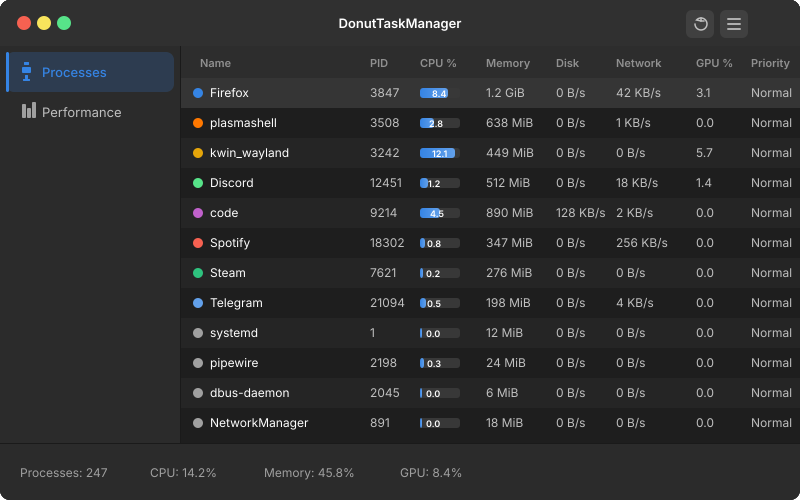

# DonutTaskManager

A lightweight, native system task manager for Linux built with **GTK4** and **Rust**.

[](https://discord.gg/ZhvPhXrdZ4)
[](https://ko-fi.com/donutsdelivery)



## Download

| Platform | Download |
|----------|----------|
| **Linux (x86_64)** | [AppImage](https://github.com/DonutsDelivery/task-manager-linux/releases/latest/download/DonutTaskManager-x86_64.AppImage) &#124; [Tarball (.tar.gz)](https://github.com/DonutsDelivery/task-manager-linux/releases/latest/download/DonutTaskManager-x86_64.tar.gz) &#124; [Binary](https://github.com/DonutsDelivery/task-manager-linux/releases/latest/download/donut-taskmgr-x86_64) |

The AppImage bundles GTK4 and libadwaita and needs glibc 2.39 or newer. Rebuild it with
`packaging/appimage/build-appimage.sh` (Docker). The Snap recipe is `packaging/snap/snapcraft.yaml`,
built with `packaging/snap/build-snap.sh`.

### Quick Install

```bash
# Download and extract
curl -LO https://github.com/DonutsDelivery/task-manager-linux/releases/latest/download/DonutTaskManager-x86_64.tar.gz
tar xzf DonutTaskManager-x86_64.tar.gz
cd DonutTaskManager

# Run
./donut-taskmgr

# Optional: install the launcher, icon and Ctrl+Shift+Esc shortcut for your user
./setup-shortcut.sh
```

> **Runtime dependencies:** GTK 4.12 or newer and libadwaita 1.4 or newer must be installed.
> Most modern Linux desktops (GNOME, KDE Plasma 6) include these by default.

> **Upgrading from Task Manager Linux:** the first launch copies your settings from
> `~/.config/task-manager-linux/` to `~/.config/donut-taskmgr/`. `make install` and the in-app
> shortcut installer remove the old `task-manager-linux` binary, launcher and shortcut.

## Features

- **Process Management** — View, end, force kill, and reprioritize running processes
- **App Grouping** — Processes grouped by application using X11 window titles, `.desktop` files, and `/proc/comm`
- **Performance Monitoring** — Real-time CPU, memory, disk, network, and GPU graphs
- **GPU Support** — NVIDIA GPU monitoring via NVML
- **DE Restart** — Quick-access button to restart desktop environment components (KDE Plasma, GNOME, XFCE, Cinnamon, MATE)
- **Critical Process Protection** — Warning dialogs prevent accidentally killing system-critical processes like systemd or kwin
- **Global Shortcut** — Register Ctrl+Shift+Esc from inside the app (KDE Plasma, GNOME, XFCE, Cinnamon, MATE, or an evdev listener elsewhere)

## Building from Source

Requires Rust and the GTK4/libadwaita development libraries (GTK 4.12+, libadwaita 1.4+).

```bash
# Arch Linux
sudo pacman -S gtk4 libadwaita

# Ubuntu/Debian
sudo apt install libgtk-4-dev libadwaita-1-dev

# Build
cargo build --release
```

The binary will be at `target/release/donut-taskmgr`. To install it for your user
(binary, icons, desktop file and AppStream metadata under `~/.local`):

```bash
make install
```

Set `PREFIX=/usr` (and `DESTDIR` for packaging) to install system-wide.

## Keyboard Shortcut

To register Ctrl+Shift+Esc as a global shortcut (KDE Plasma):

1. Launch the app
2. Click the hamburger menu (top right)
3. Click **Install Ctrl+Shift+Esc Shortcut**
4. Log out and back in

On KDE Plasma 5 and 6 you can also run the setup script, which uses `kwriteconfig6` or
`kwriteconfig5`, whichever is installed:

```bash
./scripts/setup-shortcut.sh
```

## Tech Stack

- **Rust** with GTK4-rs and libadwaita
- **procfs** for process and system data
- **nvml-wrapper** for NVIDIA GPU monitoring
- **x11rb** for window title resolution
- **flume** for async backend-to-UI communication

## License

MIT. Copyright (c) 2026 Zero Action (DonutsDelivery). See [LICENSE](LICENSE).
